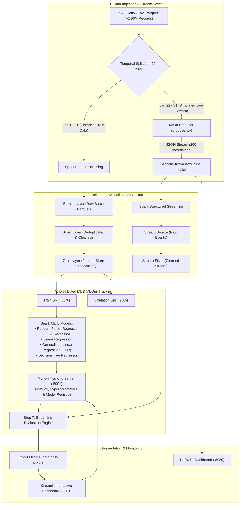

# 🚕 NYC Yellow Taxi — End-to-End Big Data & Streaming MLOps Pipeline

[](https://www.docker.com/)
[](https://kafka.apache.org/)
[](https://spark.apache.org/)
[](https://delta.io/)
[](https://mlflow.org/)
[](https://streamlit.io/)

> **Language / Dil:** **English** | [🇹🇷 Türkçe Dokümantasyon için tıklayın (README_TR.md)](README_TR.md)

---

## 📌 Executive Summary

This project implements an **enterprise-grade, end-to-end distributed Big Data and Streaming MLOps pipeline** using the NYC Yellow Taxi dataset (~2.96 million trip records, January 2024). 

The platform simulates a real-world enterprise architecture featuring:
- **Asynchronous Data Ingestion** using Apache Kafka to decouple data producers from downstream consumers.
- **Lakehouse Medallion Architecture** (Bronze, Silver, Gold layers) powered by Delta Lake and Apache Spark Structured Streaming, ensuring ACID transaction guarantees and schema enforcement.
- **Advanced Feature Engineering** capturing traffic congestion patterns, airport flat rates, and rush-hour dynamics.
- **Distributed Machine Learning** with Spark MLlib across 5 regression algorithms.
- **Full MLOps Lifecycle Tracking** via MLflow to log parameters, metrics, and serialized model artifacts.
- **Real-Time Stream Model Validation** testing models against simulated live Kafka streams.
- **Interactive Decision-Support Dashboard** built with Streamlit and Plotly for real-time monitoring and business intelligence.

---

## 🏗️ System Architecture



---

## 🛠️ Technology Stack & Microservices

The entire ecosystem is containerized into **7 isolated microservices** managed by Docker Compose over a dedicated bridge network:

| Service | Container Image / Base | Internal / Host Port | Purpose & Key Features |
| :--- | :--- | :--- | :--- |
| **`zookeeper`** | `confluentinc/cp-zookeeper:7.3.0` | `2181:2181` | High-availability coordination, broker management, and Kafka metadata synchronization. |
| **`kafka`** | `confluentinc/cp-kafka:7.3.0` | `9092:9092`, `29092` | Distributed event streaming broker. Manages partition assignment and message durability for `taxi_trips`. |
| **`kafka-ui`** | `provectuslabs/kafka-ui:latest` | `8080:8080` | Web-based telemetry dashboard for real-time topic monitoring, consumer lag analysis, and message inspection. |
| **`spark-workspace`** | `jupyter/pyspark-notebook:spark-3.5.0` | `8888:8888`, `4040:4040` | PySpark distributed computation engine and Jupyter Lab interface. Integrated with Delta Lake 3.1.0 and Kafka SQL connectors. |
| **`kafka-producer`** | Custom Python (`python:3.9-slim`) | Internal | Micro-batch streaming producer sending ~200 records/sec from Parquet to Kafka with backoff and reconnection logic. |
| **`mlflow-server`** | `python:3.9-slim` | `5001:5001` | Centralized MLOps tracking server backed by SQLite (`mlflow.db`) and artifact directory (`/mlruns`). |
| **`streamlit-dashboard`**| Custom Python (`python:3.9-slim`) | `8501:8501` | Interactive BI web dashboard connecting dynamically to MLflow and processed data artifacts. |

---

## 📂 Repository Structure

```
nycrepo/
├── docker-compose.yml              # Multi-container orchestration (7 microservices)
├── README.md                       # Main English documentation
├── README_TR.md                    # Detailed Turkish documentation
├── big_data_rapor.pdf              # Academic project technical report
├── big_data_sunum.pdf              # Comprehensive project presentation slides
├── data/                           # Data storage (Parquet, Delta Lake tables, CSV exports)
│   ├── yellow_tripdata_2024-01.parquet
│   ├── model_metrics.csv           # Model evaluation results
│   ├── stream_metrics.csv          # Real-time streaming evaluation results
│   └── feature_importance.csv      # Top feature weights
├── mlruns/                         # MLflow experiment metadata and artifacts
│   ├── 1/                          # Experiment run tracking
│   └── mlflow.db                   # SQLite backend database
├── spark-env/
│   └── Dockerfile                  # Custom PySpark 3.5.0 + Delta Lake + MLflow image
├── kafka-producer/
│   ├── Dockerfile                  # Lightweight Python producer container
│   ├── producer.py                 # High-throughput Kafka streaming script
│   └── requirements.txt            # Producer dependencies (kafka-python, pandas, pyarrow)
├── dashboard/
│   ├── Dockerfile                  # Streamlit dashboard container
│   ├── app.py                      # Multi-panel Streamlit analytics dashboard
│   └── requirements.txt            # Dashboard dependencies (streamlit, plotly, mlflow)
└── notebooks/                      # Sequential end-to-end processing pipeline
    ├── 01_docker_setup.ipynb       # Step 1: Docker infrastructure documentation & health checks
    ├── 02_kafka_streaming.ipynb    # Step 2: Kafka streaming producer testing & topic telemetry
    ├── 03_spark_streaming.ipynb    # Step 3: Spark Structured Streaming & Medallion Lakehouse
    ├── 04_eda.ipynb                # Step 4: Exploratory Data Analysis & visual insights
    ├── 05_feature_engineering.ipynb# Step 5: Gold Layer feature engineering & domain logic
    ├── 06_1_gbt.ipynb              # Step 6.1: Gradient-Boosted Trees (GBT) regression & MLflow
    ├── 06_2_random_forest_regressor.ipynb # Step 6.2: Random Forest regression & MLflow
    ├── 06_3_linear_regression.ipynb# Step 6.3: Linear regression with regularization & MLflow
    ├── 06_4_decision_tree.ipynb    # Step 6.4: Single Decision Tree baseline & MLflow
    ├── 06_5_glr.ipynb              # Step 6.5: Generalized Linear Regression (GLR) & MLflow
    └── 07_models_test.ipynb        # Step 7: Multi-model evaluation & live stream validation
```

---

## 🔄 End-to-End Implementation Workflow

The implementation follows a structured 8-step chronological engineering lifecycle:

```
[Step 1: Docker Setup] ──▶ [Step 2: Kafka Streaming] ──▶ [Step 3: Spark & Delta Lake]
                                                                     │
[Step 6: MLlib & MLflow] ◀── [Step 5: Feature Eng (Gold)] ◀── [Step 4: Spark EDA (Silver)]
         │
         ▼
[Step 7: Streaming Test] ──▶ [Step 8: Streamlit Dashboard]
```

### 1. Infrastructure & Container Orchestration (`01_docker_setup.ipynb`)
- Configures Docker Compose with network bridges, volume persistence, and dependency graphs.
- Establishes health-check verification and port mappings across all 7 distributed nodes.

### 2. Event-Driven Streaming Ingestion (`02_kafka_streaming.ipynb` & `producer.py`)
- Employs a temporal data split: trips occurring on or after **January 22, 2024** are reserved strictly for streaming simulation.
- `producer.py` serializes Parquet batches into JSON events and publishes them to the Kafka broker (`taxi_trips` topic) at a controlled throughput of **200 records/sec**, simulating real-time vehicle telematics.

### 3. Lakehouse Medallion Architecture (`03_spark_streaming.ipynb`)
- **Batch Pipeline (Jan 1–21):**
  - **Bronze Layer:** Unmodified raw records written to Delta Lake format (`data/delta/taxi_trips/bronze`).
  - **Silver Layer:** Schema validation and rigorous data hygiene:
    - Filters: `trip_distance > 0`, `0 < total_amount < 500`, `passenger_count > 0`.
    - Drop records with null pickup/dropoff timestamps.
    - Deduplication: `dropDuplicates(["tpep_pickup_datetime", "PULocationID", "DOLocationID", "total_amount"])`.
    - Persisted to `data/delta/taxi_trips/silver`.
- **Structured Streaming Pipeline (Jan 22–31):**
  - Ingests `taxi_trips` from Kafka via micro-batching.
  - JSON payloads are parsed using an explicit schema (`taxi_schema`).
  - Real-time Silver transformations are written with Delta checkpointing for fault-tolerant, exactly-once append semantics (`stream_bronze` and `stream_silver`).

### 4. Exploratory Data Analysis (`04_eda.ipynb`)
- Statistical distribution analysis and PySpark aggregations exported as visual reports:
  - **Hourly Trip Trend:** Peak transit volume identified during evening rush hour (17:00–19:00).
  - **Payment Method Distribution:** Credit card transactions dominate the market share (>80%).
  - **Fare Distribution:** Majority of urban trips fall within the $10–$30 interval.
  - **Trip Distance vs Total Amount:** Validates strong linear correlation while capturing airport flat-rate anomalies.

### 5. Advanced Domain Feature Engineering (`05_feature_engineering.ipynb`)
Creates domain-specific numerical and categorical features saved to the **Gold Layer** (`data/delta/features`):

| Feature Name | Computation Formula / Logic | Business Rationale & Domain Purpose |
| :--- | :--- | :--- |
| `trip_duration_min` | `(dropoff - pickup) / 60` | Captures urban traffic delays where distance is short but travel time is high. Filtered to $(0, 180]$ minutes. |
| `average_speed` | `trip_distance / (duration / 60)` | Proxy for real-time congestion; filtered to remove physically impossible values $(0, 100]$ mph. |
| `pickup_hour` | `hour(tpep_pickup_datetime)` | Distinguishes between daytime commercial travel and nighttime surcharges. |
| `day_of_week` | `dayofweek(tpep_pickup_datetime)` | Models weekday commuter density vs. weekend leisure travel. |
| `is_airport_trip` | `RatecodeID in (2, 3) OR Airport_fee > 0` | Binary indicator flagging fixed-rate airport transfers (JFK / Newark flat rates). |
| `is_rush_hour` | `pickup_hour in (8, 9, 16, 17, 18, 19)` | Captures mandatory peak-traffic congestion surcharges. |

### 6. Distributed Machine Learning with MLflow (`06_1` through `06_5`)
- Features assembled into a dense vector via Spark's `VectorAssembler`.
- Stratified 80/20 train/validation split (`randomSplit(seed=42)`).
- 5 candidate regression algorithms trained and tracked via the centralized MLflow server:
  1. **Random Forest Regressor** (`numTrees=20`, `maxDepth=5`)
  2. **Gradient-Boosted Trees (GBT) Regressor** (`maxIter=20`, `maxDepth=5`)
  3. **Linear Regression** (`regParam=0.1`, `elasticNetParam=0.5`)
  4. **Generalized Linear Regression (GLR)** (`family="gaussian"`, `link="identity"`)
  5. **Decision Tree Regressor** (`maxDepth=5`)
- Automatically logs all hyperparameters, evaluation metrics (RMSE, MAE, $R^2$), and serialized Spark ML model artifacts.

### 7. Multi-Model Evaluation & Live Stream Testing (`07_models_test.ipynb`)
- Dynamically loads serialized models directly from MLflow.
- Evaluates model generalization against the **unseen streaming test set** (Jan 22–31 stream from Delta Lake).
- Conducts residual error distribution analysis to verify normality and detect potential model drift.
- Exports production summary metrics to `model_metrics.csv`, `stream_metrics.csv`, and `feature_importance.csv`.

### 8. Interactive Analytics Dashboard (`dashboard/app.py`)
- Live Streamlit web application providing:
  - High-level KPI cards (Total trip volume, average distance, best model accuracy).
  - Dynamic MLflow metric comparison charts (Interactive Plotly grouped bar charts).
  - Live streaming evaluation results and residual error distribution plots.
  - Horizontal bar charts displaying feature importance rankings.
  - Interactive Exploratory Data Analysis modules.

---

## 📊 Empirical Model Benchmark Results

All models were evaluated under identical conditions on both the **Historical Validation Split** and the **Unseen Streaming Test Stream**:

| Model Algorithm | Validation RMSE ($) | Validation MAE ($) | Validation $R^2$ Score | Streaming Test $R^2$ | Rank |
| :--- | :---: | :---: | :---: | :---: | :---: |
| **Random Forest Regressor** 🏆 | **5.54 – 6.98** | **2.78 – 2.91** | **0.902 – 0.922** | **90.20%** | **#1 (Best)** |
| **Gradient-Boosted Trees (GBT)** | 5.80 – 7.13 | 2.91 – 3.01 | 0.898 – 0.915 | 89.81% | #2 |
| **Linear Regression** | 6.43 – 7.26 | 3.39 – 3.42 | 0.894 – 0.895 | 89.42% | #3 |
| **Generalized Linear Regression (GLR)** | 6.43 – 7.26 | 3.39 – 3.42 | 0.894 – 0.895 | 89.42% | #3 |
| **Decision Tree Regressor** | 6.16 – 7.52 | 3.37 – 3.45 | 0.887 – 0.904 | 88.74% | #5 |

### 🔍 Key Findings & Feature Importance
1. **Primary Predictor (`trip_distance`):** Accounts for **~85%** of the model's predictive capability, forming the baseline linear component of the fare calculation.
2. **Temporal & Congestion Correction:** `trip_duration_min` and `average_speed` provide non-linear corrections when vehicles are immobilized in Manhattan traffic.
3. **Domain Exception Handling:** `is_airport_trip` accounts for NYC Taxi and Limousine Commission (TLC) flat rates, significantly reducing peak error spikes on high-value trips.

---

## 🌐 Port Mappings & Services

When the cluster is running, the following web user interfaces are available locally:

| Interface | URL | Credentials / Notes |
| :--- | :--- | :--- |
| **Streamlit Analytics Dashboard** | [http://localhost:8501](http://localhost:8501) | Interactive KPI monitoring, model metrics, and EDA |
| **Jupyter Lab (Spark Workspace)** | [http://localhost:8888](http://localhost:8888) | Token-free access for executing PySpark notebooks |
| **MLflow MLOps Tracking** | [http://localhost:5001](http://localhost:5001) | Model registry, experiment history, and artifact browser |
| **Kafka UI** | [http://localhost:8080](http://localhost:8080) | Topic partitions, consumer offsets, and live message payload inspection |
| **Spark Application UI** | [http://localhost:4040](http://localhost:4040) | Active stage tracking, DAG visualization, and streaming query progress |

---

## 🚀 Quickstart Guide

### Prerequisites
- [Docker Desktop](https://www.docker.com/products/docker-desktop/) (allocate at least 4 CPU cores and 8 GB RAM in Docker preferences).
- `curl` or `wget` for dataset download.

### 1. Clone & Download Dataset
```bash
git clone https://github.com/Melissportakall/bigdataproject.git
cd bigdataproject

# Download NYC Yellow Taxi January 2024 Parquet (~50 MB)
mkdir -p data
curl -o data/yellow_tripdata_2024-01.parquet \
  https://d37ci6vzurychx.cloudfront.net/trip-data/yellow_tripdata_2024-01.parquet
```

### 2. Build and Launch the Distributed Cluster
```bash
docker-compose up -d --build
```

Verify that all 7 services are running:
```bash
docker-compose ps
```

### 3. Run the Processing Pipeline
Access Jupyter Lab at [http://localhost:8888](http://localhost:8888) and execute the notebooks in sequence:
1. `notebooks/01_docker_setup.ipynb` — Environment verification.
2. `notebooks/02_kafka_streaming.ipynb` — Producer tests and topic metrics.
3. `notebooks/03_spark_streaming.ipynb` — Populate Bronze and Silver Delta Lake tables.
4. `notebooks/04_eda.ipynb` — Run aggregations and export visual plots.
5. `notebooks/05_feature_engineering.ipynb` — Produce Gold Feature Store.
6. `notebooks/06_1_gbt.ipynb` through `06_5_glr.ipynb` — Train all 5 regression models.
7. `notebooks/07_models_test.ipynb` — Benchmark on streaming data and export CSVs for the dashboard.

### 4. View the Interactive Dashboard
Navigate to [http://localhost:8501](http://localhost:8501) to explore live KPIs, model comparisons, feature importance, and streaming residuals.

### 5. Teardown
```bash
docker-compose down
```
*(To clear volumes and checkpoints completely: `docker-compose down -v`)*

---

## 👥 Authors & Academic Attribution
- **Author:** Melis Portakal
- **Course:** Introduction to Big Data Analytics (Büyük Veri Analizine Giriş)
- **Academic Advisor:** Dr. Ayşe Gül Eker
- **Term:** 2025–2026 Spring Semester