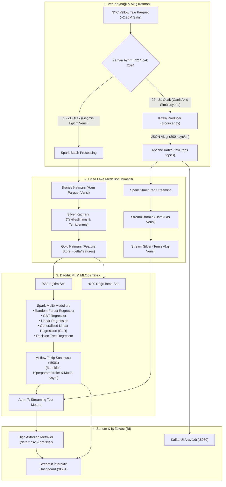

# 🚕 NYC Yellow Taxi — Uçtan Uca Büyük Veri ve Streaming MLOps Pipeline'ı

[](https://www.docker.com/)
[](https://kafka.apache.org/)
[](https://spark.apache.org/)
[](https://delta.io/)
[](https://mlflow.org/)
[](https://streamlit.io/)

> **Dil / Language:** **Türkçe** | [🇬🇧 Click here for English Documentation (README.md)](README.md)

---

## 📌 Yönetici Özeti (Proje Amacı)

Bu proje, **NYC Yellow Taxi Ocak 2024** veri seti (~2.96 Milyon yolculuk kaydı) kullanılarak geliştirilmiş, endüstriyel standartlarda **uçtan uca dağıtık bir Büyük Veri ve Streaming MLOps boru hattıdır (pipeline)**.

Projenin temel amacı ve mimari yetkinlikleri şunlardır:
- **Asenkron Veri İletimi:** Veri üreticisi (Producer) ile veri tüketicisi (Spark) arasındaki sıkı bağımlılığı ortadan kaldıran Apache Kafka tabanlı akış simülasyonu.
- **Lakehouse Medallion Mimarisi:** Delta Lake ve Spark Structured Streaming kullanılarak kurulan, ACID işlem garantisi ve şema doğrulaması sunan 3 aşamalı (Bronze, Silver, Gold) katmanlı veri gölü.
- **İleri Düzey Özellik Mühendisliği (Feature Engineering):** Şehir içi trafik sıkışıklığını, havaalanı sabit tarifelerini ve yoğun saat ek ücretlerini modelleyen dinamik öznitelik üretimi.
- **Dağıtık Makine Öğrenmesi:** Spark MLlib ile 5 farklı regresyon modelinin eğitimi ve ölçeklenebilir tahmini.
- **Uçtan Uca MLOps Yaşam Döngüsü:** MLflow ile hiperparametrelerin, metriklerin ve eğitilmiş Spark modellerinin merkezi olarak versiyonlanıp takip edilmesi.
- **Canlı Akış (Streaming) Üzerinde Model Doğrulama:** Modellerin gerçek zamanlı Kafka akışından gelen daha önce görülmemiş veriler üzerinde test edilmesi.
- **İnteraktif Karar Destek Paneli:** Streamlit ve Plotly kullanılarak geliştirilen, KPI'ları ve model analizlerini anlık gösteren analitik arayüz.

---

## 🏗️ Sistem Mimarisi



---

## 🛠️ Teknoloji Yığını ve Mikroservisler

Tüm platform, Docker Compose tarafından izole bir bridge ağı üzerinde yönetilen **7 bağımsız mikroservis** halinde çalışır:

| Servis Adı | Temel İmaj / Altyapı | Port Eşleme | Projedeki Görevi ve Özellikleri |
| :--- | :--- | :--- | :--- |
| **`zookeeper`** | `confluentinc/cp-zookeeper:7.3.0` | `2181:2181` | Kafka broker koordinasyonu, lider seçimi ve metadata senkronizasyonu. |
| **`kafka`** | `confluentinc/cp-kafka:7.3.0` | `9092:9092`, `29092` | Dağıtık olay akış platformu. `taxi_trips` topic'i üzerinde mesaj kalıcılığı ve kuyruk yönetimi. |
| **`kafka-ui`** | `provectuslabs/kafka-ui:latest` | `8080:8080` | Topic'leri, mesaj yüklerini, partisyonları ve consumer lag değerlerini anlık izleyen web arayüzü. |
| **`spark-workspace`** | `jupyter/pyspark-notebook:spark-3.5.0` | `8888:8888`, `4040:4040` | PySpark dağıtık veri işleme motoru ve Jupyter Lab. Delta Lake 3.1.0 ve Kafka SQL bağlayıcılarıyla donatılmıştır. |
| **`kafka-producer`** | Özel Python (`python:3.9-slim`) | Dahili Ağ | Parquet dosyasından okunan verileri saniyede ~200 kayıtlık mikro-batch'ler halinde Kafka'ya JSON olarak iletir. |
| **`mlflow-server`** | `python:3.9-slim` | `5001:5001` | SQLite (`mlflow.db`) backend'li ve `/mlruns` dosya köklü merkezi model yönetim ve deney takip sunucusu. |
| **`streamlit-dashboard`**| Özel Python (`python:3.9-slim`) | `8501:8501` | MLflow'a ve işlenmiş verilere dinamik bağlanan kullanıcı dostu karar destek paneli. |

---

## 📂 Proje Dizin Yapısı

```
nycrepo/
├── docker-compose.yml              # Tüm mikroservisleri orkestre eden yapılandırma
├── README.md                       # Ana İngilizce dokümantasyon
├── README_TR.md                    # Ayrıntılı Türkçe dokümantasyon
├── big_data_rapor.pdf              # Akademik dönem projesi teknik raporu
├── big_data_sunum.pdf              # Kapsamlı proje sunum slaytları
├── data/                           # Veri depolama dizini (Parquet, Delta tabloları, CSV çıktıları)
│   ├── yellow_tripdata_2024-01.parquet
│   ├── model_metrics.csv           # Model doğrulama metrikleri
│   ├── stream_metrics.csv          # Streaming test sonuçları
│   └── feature_importance.csv      # Öznitelik önem düzeyleri
├── mlruns/                         # MLflow deney veritabanı ve modeller
│   ├── 1/                          # Deney çalışma klasörü
│   └── mlflow.db                   # SQLite veritabanı
├── spark-env/
│   └── Dockerfile                  # PySpark 3.5.0 + Delta Lake + MLflow özel imajı
├── kafka-producer/
│   ├── Dockerfile                  # Hafif Python producer konteyneri
│   ├── producer.py                 # Yüksek verimli Kafka streaming kodu
│   └── requirements.txt            # Producer kütüphaneleri (kafka-python, pandas, pyarrow)
├── dashboard/
│   ├── Dockerfile                  # Streamlit dashboard konteyneri
│   ├── app.py                      # Çok panelli interaktif analitik arayüzü
│   └── requirements.txt            # Dashboard kütüphaneleri (streamlit, plotly, mlflow)
└── notebooks/                      # Sıralı boru hattı notebook'ları
    ├── 01_docker_setup.ipynb       # Adım 1: Docker ortamı kurulumu ve sistem kontrolleri
    ├── 02_kafka_streaming.ipynb    # Adım 2: Kafka veri akışı testi ve topic istatistikleri
    ├── 03_spark_streaming.ipynb    # Adım 3: Spark Structured Streaming ve Delta Lake katmanları
    ├── 04_eda.ipynb                # Adım 4: Keşifsel Veri Analizi (EDA) ve görsel çıktılar
    ├── 05_feature_engineering.ipynb# Adım 5: Gold katmanı ve özellik mühendisliği mantığı
    ├── 06_1_gbt.ipynb              # Adım 6.1: Gradient-Boosted Trees (GBT) regresyonu ve MLflow
    ├── 06_2_random_forest_regressor.ipynb # Adım 6.2: Random Forest regresyonu ve MLflow
    ├── 06_3_linear_regression.ipynb# Adım 6.3: Lineer Regresyon ve MLflow
    ├── 06_4_decision_tree.ipynb    # Adım 6.4: Karar Ağacı taban çizgisi ve MLflow
    ├── 06_5_glr.ipynb              # Adım 6.5: Genelleştirilmiş Lineer Regresyon (GLR) ve MLflow
    └── 07_models_test.ipynb        # Adım 7: Model karşılaştırma ve canlı akış üzerinde test
```

---

## 🔄 Adım Adım Uygulama Süreci

Proje mantıksal bir sırayla 8 ana aşamada geliştirilmiştir:

```
[Adım 1: Docker Kurulumu] ──▶ [Adım 2: Kafka Akışı] ──▶ [Adım 3: Spark & Delta Lake]
                                                                  │
[Adım 6: MLlib & MLflow]  ◀── [Adım 5: Feature Eng (Gold)] ◀── [Adım 4: Spark EDA (Silver)]
         │
         ▼
[Adım 7: Streaming Test]  ──▶ [Adım 8: Streamlit Dashboard]
```

### 1. Altyapı ve Konteynerizasyon (`01_docker_setup.ipynb`)
- `docker-compose.yml` üzerinde servislerin bağımlılıkları, ağ köprüleri ve volume mount'ları kurgulandı.
- Tüm mikroservislerin erişilebilirliği ve port yönlendirmeleri doğrulandı.

### 2. Kafka ile Streaming Veri Üretimi (`02_kafka_streaming.ipynb` & `producer.py`)
- Veri zaman ekseninde ikiye bölündü: **22 Ocak 2024 ve sonrası** canlı veri akışı simülasyonu için ayrıldı.
- `producer.py`, Parquet verisini okuyup datetime alanlarını ISO-8601 formatına çevirerek saniyede **200 kayıtlık** hızla `taxi_trips` topic'ine JSON olarak iletir.

### 3. Lakehouse Medallion Mimarisi (`03_spark_streaming.ipynb`)
- **Tarihsel Batch İşleme (1–21 Ocak):**
  - **Bronze Katmanı:** Ham verinin format değişikliği olmaksızın Delta formatında kaydedildiği katman (`data/delta/taxi_trips/bronze`).
  - **Silver Katmanı:** Veri temizleme kuralları:
    - `trip_distance > 0`, `0 < total_amount < 500`, `passenger_count > 0`.
    - Eksik zaman damgalarının (`null`) elenmesi.
    - Biniş zamanı, lokasyonlar ve ücret üzerinden tekilleştirme (`dropDuplicates`).
    - Temiz veri `data/delta/taxi_trips/silver` yoluna kaydedildi.
- **Structured Streaming İşleme (22–31 Ocak):**
  - Kafka `taxi_trips` topic'i mikro-batch mantığıyla dinlendi.
  - JSON veriler tanımlı şema (`taxi_schema`) ile parse edilip, checkpointing desteğiyle `stream_bronze` ve `stream_silver` Delta tablolarına append modunda yazıldı.

### 4. Keşifsel Veri Analizi - EDA (`04_eda.ipynb`)
- Silver tablosu üzerinden PySpark ile analizler yapılarak görsel grafikler oluşturuldu:
  - **Saatlik Yoğunluk:** Akşam iş çıkışında (17:00–19:00) en yüksek yolculuk hacmine ulaşıldığı belirlendi.
  - **Ödeme Türü:** Kredi kartı kullanımının %80'in üzerinde olduğu görüldü.
  - **Ücret Dağılımı:** Yolculukların ağırlıklı olarak 10$–30$ bandında olduğu saptandı.
  - **Mesafe vs Ücret:** Mesafe arttıkça ücretin doğrusal arttığı, ancak sabit tarifeli havaalanı yolculuklarının aykırı kümelenmeler oluşturduğu tespit edildi.

### 5. İleri Düzey Özellik Mühendisliği (`05_feature_engineering.ipynb`)
ML modellerinin tahmin gücünü artırmak üzere iş kuralları uygulanarak **Gold Katmanı** (`data/delta/features`) oluşturuldu:

| Üretilen Özellik | Formül / Tanım | İş Mantığı ve Modele Katkısı |
| :--- | :--- | :--- |
| `trip_duration_min` | `(dropoff - pickup) / 60` | Şehir içi trafikte mesafenin kısa ama sürenin uzun olduğu durumları yakalar (0-180 dk arası filtrelendi). |
| `average_speed` | `trip_distance / (duration / 60)` | Trafik tıkanıklığı göstergesi. Mantıksız hızlar elendi (0-100 mil/saat). |
| `pickup_hour` | `hour(tpep_pickup_datetime)` | Gece/gündüz tarife farklarını yakalar (0-23). |
| `day_of_week` | `dayofweek(tpep_pickup_datetime)` | Hafta içi iş trafiği ile hafta sonu seyahat farkını yansıtır. |
| `is_airport_trip` | `RatecodeID in (2, 3) OR Airport_fee > 0` | Havaalanı sabit ücretli (flat rate) yolculukları temsil eden ikili (binary) değişken. |
| `is_rush_hour` | `pickup_hour in (8, 9, 16, 17, 18, 19)` | Zirve saatlerde uygulanan ek ücret (surcharge) etkisini modelletir. |

### 6. Dağıtık Makine Öğrenmesi ve MLflow Takibi (`06_1` - `06_5`)
- Özellikler `VectorAssembler` ile tek bir vektöre toplandı.
- Veri kümesi %80 Eğitim ve %20 Doğrulama olarak ayrıldı (`randomSplit`).
- 5 farklı regresyon modeli eğitilerek tüm parametreler ve metrikler MLflow'a kaydedildi:
  1. **Random Forest Regressor** (`numTrees=20`, `maxDepth=5`)
  2. **Gradient-Boosted Trees (GBT) Regressor** (`maxIter=20`, `maxDepth=5`)
  3. **Linear Regression** (`regParam=0.1`, `elasticNetParam=0.5`)
  4. **Generalized Linear Regression (GLR)** (`family="gaussian"`, `link="identity"`)
  5. **Decision Tree Regressor** (`maxDepth=5`)

### 7. Model Karşılaştırma ve Canlı Akış Testi (`07_models_test.ipynb`)
- Eğitilen modeller MLflow sunucusundan dinamik olarak çekildi.
- Kafka üzerinden canlı olarak akıtılmış olan 22–31 Ocak streaming verisi üzerinde test edildi.
- Gerçek vs Tahmin saçılım grafikleri ve artık (residual) hata dağılımları çıkarıldı; normal dağılım gösterdiği doğrulanarak model kararlılığı ispatlandı.
- Dashboard için `model_metrics.csv`, `stream_metrics.csv` ve `feature_importance.csv` dosyaları üretildi.

### 8. İnteraktif Web Dashboard'u (`dashboard/app.py`)
- Streamlit tabanlı arayüz ile:
  - Toplam yolculuk hacmi ve ortalama mesafe KPI kartları,
  - MLflow'dan anlık çekilen model metrikleri ve interaktif kıyaslama çubukları,
  - Canlı streaming test tablosu ve hata dağılım grafikleri,
  - Özellik önem düzeyleri ve EDA grafikleri sunulmaktadır.

---

## 📊 Model Başarı Karşılaştırması

Tüm modeller aynı doğrulama ve canlı akış test verisi üzerinde değerlendirilmiştir:

| Model Algoritması | Doğrulama RMSE ($) | Doğrulama MAE ($) | Doğrulama $R^2$ Skoru | Streaming Test $R^2$ | Sıralama |
| :--- | :---: | :---: | :---: | :---: | :---: |
| **Random Forest Regressor** 🏆 | **5.54 – 6.98** | **2.78 – 2.91** | **0.902 – 0.922** | **%90.20** | **1. (En İyi)** |
| **Gradient-Boosted Trees (GBT)** | 5.80 – 7.13 | 2.91 – 3.01 | 0.898 – 0.915 | %89.81 | 2. |
| **Linear Regression** | 6.43 – 7.26 | 3.39 – 3.42 | 0.894 – 0.895 | %89.42 | 3. |
| **Generalized Linear Regression (GLR)** | 6.43 – 7.26 | 3.39 – 3.42 | 0.894 – 0.895 | %89.42 | 3. |
| **Decision Tree Regressor** | 6.16 – 7.52 | 3.37 – 3.45 | 0.887 – 0.904 | %88.74 | 5. |

### 🔍 Kritik Çıkarımlar & Öznitelik Önemi
1. **Birincil Belirleyici (`trip_distance`):** Ücret tahmininde **~%85** ağırlıkla en baskın değişkendir.
2. **Trafik & Bekleme Düzeltmesi:** `trip_duration_min` ve `average_speed`, Manhattan trafiğindeki sıkışıklıkları hesaba katarak doğrusal olmayan sapmaları düzeltir.
3. **Sabit Tarife Tespiti:** `is_airport_trip`, JFK gibi sabit ücretli hatları başarıyla ayrıştırarak uç değer hatalarını (outlier error) ciddi oranda düşürmüştür.

---

## 🌐 Servisler ve Portlar

Sistem ayağa kalktığında erişilebilecek yerel adresler:

| Arayüz | URL | Açıklama |
| :--- | :--- | :--- |
| **Streamlit Dashboard** | [http://localhost:8501](http://localhost:8501) | Canlı KPI'lar, model kıyaslamaları ve EDA analizleri |
| **Jupyter Lab (Spark)** | [http://localhost:8888](http://localhost:8888) | Spark notebook'larının çalıştırıldığı geliştirme ortamı |
| **MLflow Arayüzü** | [http://localhost:5001](http://localhost:5001) | Model deneyleri, parametre ve metrik takibi |
| **Kafka UI** | [http://localhost:8080](http://localhost:8080) | Topic mesajları, broker durumu ve tüketici izleme |
| **Spark UI** | [http://localhost:4040](http://localhost:4040) | Aktif Spark job'ları, DAG görselleştirmesi ve streaming durumu |

---

## 🚀 Hızlı Başlangıç

### Gereksinimler
- [Docker Desktop](https://www.docker.com/products/docker-desktop/) (Docker kaynaklarından en az 4 CPU ve 8 GB RAM verilmesi önerilir).
- Veri dosyasını indirmek için `curl` aracı.

### 1. Depoyu Klonlayın ve Veriyi İndirin
```bash
git clone https://github.com/Melissportakall/bigdataproject.git
cd bigdataproject

# NYC Yellow Taxi Ocak 2024 Parquet dosyasını indirin (~50 MB)
mkdir -p data
curl -o data/yellow_tripdata_2024-01.parquet \
  https://d37ci6vzurychx.cloudfront.net/trip-data/yellow_tripdata_2024-01.parquet
```

### 2. Mikroservisleri Başlatın
```bash
docker-compose up -d --build
```

Konteynerlerin çalıştığını kontrol edin:
```bash
docker-compose ps
```

### 3. Notebook'ları Sırasıyla Çalıştırın
[http://localhost:8888](http://localhost:8888) adresinden Jupyter Lab'e bağlanın ve notebook'ları sırayla yürütün:
1. `notebooks/01_docker_setup.ipynb` — Ortam doğrulaması.
2. `notebooks/02_kafka_streaming.ipynb` — Producer testi ve topic kontrolü.
3. `notebooks/03_spark_streaming.ipynb` — Bronze ve Silver Delta Lake tablolarını oluşturma.
4. `notebooks/04_eda.ipynb` — Keşifsel veri analizi ve görsel grafik üretimi.
5. `notebooks/05_feature_engineering.ipynb` — Gold katmanı (özellikler) üretimi.
6. `notebooks/06_1_gbt.ipynb` ... `06_5_glr.ipynb` — 5 regresyon modelinin eğitimi ve MLflow kaydı.
7. `notebooks/07_models_test.ipynb` — Canlı akış verisiyle test ve dashboard CSV'lerinin üretimi.

### 4. Dashboard'u İnceleyin
[http://localhost:8501](http://localhost:8501) adresine giderek model metriklerini, canlı akış test sonuçlarını ve interaktif grafikleri inceleyin.

### 5. Servisleri Durdurma
```bash
docker-compose down
```
*(Tüm volume ve Delta Lake verilerini sıfırlamak için: `docker-compose down -v`)*

---
